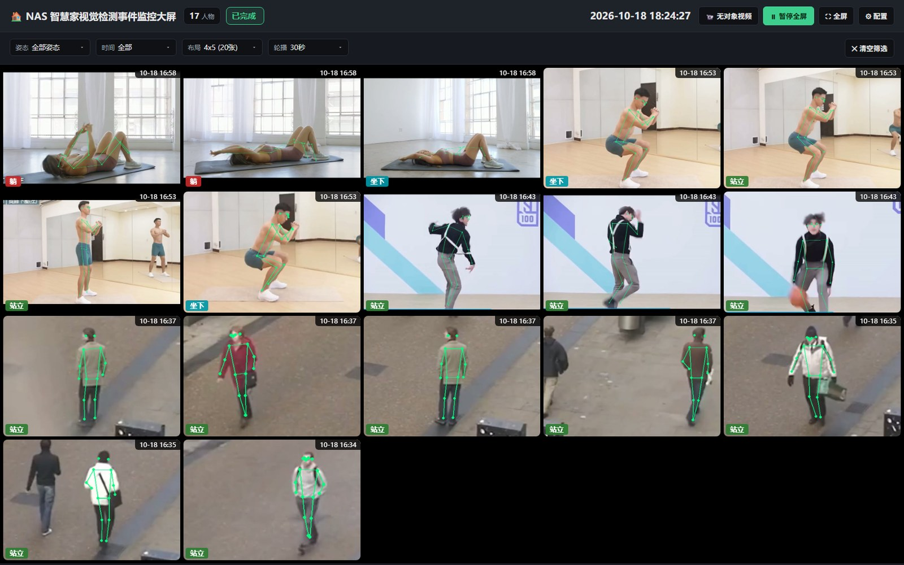
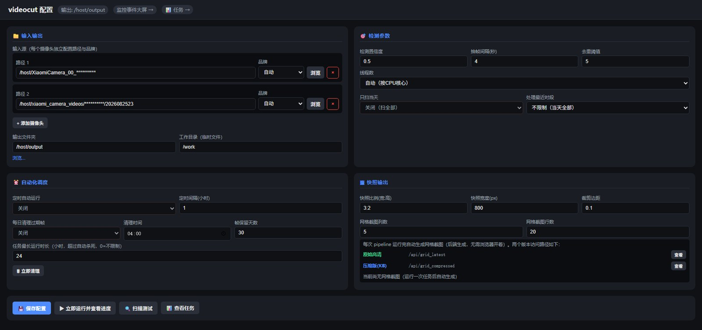
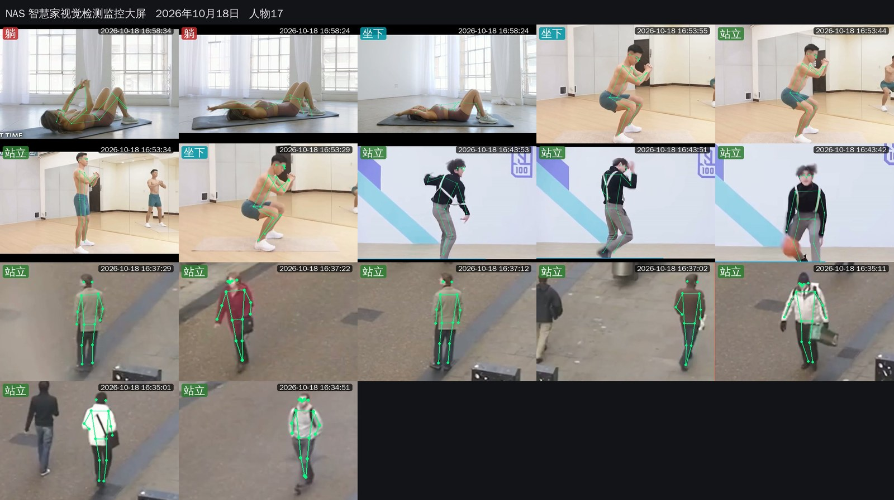
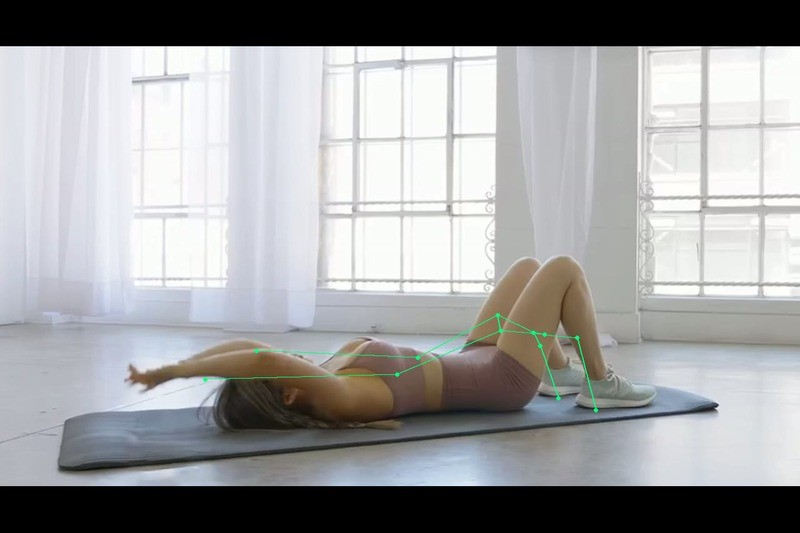
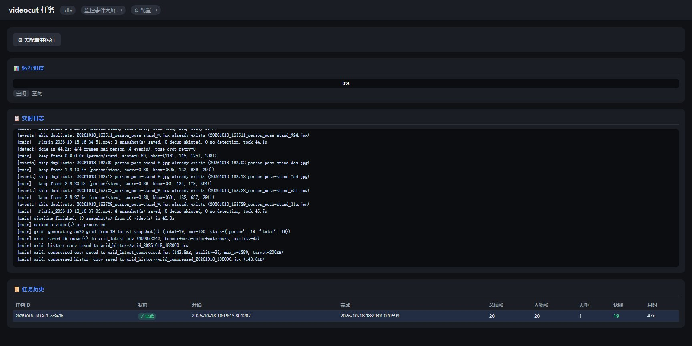

<div align="center">

# VideoCut · NAS 智慧家视觉检测大屏

**把小米摄像头 / NAS 家庭监控录像，变成一张会自己更新的 AI 事件大屏。**

[](https://www.python.org/)
[](https://flask.palletsprojects.com/)
[](https://docs.ultralytics.com/)
[](https://docs.openvino.ai/)
[](https://www.sqlite.org/)
[](LICENSE)
[](https://www.docker.com/)

**零 GPU 也能跑 · 容器启动即全自动 · 为小米摄像头 NAS 录像格式深度适配**

</div>

---

## 📸 界面预览

<table>
<tr>
<td width="50%"><br><sub><b>事件大屏</b> — 4×5 轮播、顶部状态栏、5 秒无操作自动进全屏</sub></td>
<td width="50%"><br><sub><b>配置页</b> — 输入输出 / 检测参数 / 自动化调度 / 快照输出</sub></td>
</tr>
<tr>
<td><br><sub><b>网格拼接大图</b> — 后端 PIL 拼接，含姿态彩色徽章与时间水印</sub></td>
<td><br><sub><b>事件快照</b> — 检测框 + 17 点骨架 + 姿态标签 + 时间戳</sub></td>
</tr>
<tr>
<td colspan="2"><br><sub><b>运行日志 / 任务历史</b> — 逐帧级进度、每视频明细表、单任务手动终止</sub></td>
</tr>
</table>

> ℹ️ **关于示例图**：`docs/images/` 下的界面图均为项目自身实机运行截图（作者自有的测试录像跑完整管线产出），
> 其中涉及的人像与录像画面由作者本人授权公开；仓库**不附带任何原始录像文件**，也不包含设备 ID、SN、账号等隐私信息。
> 你复现本项目时请自行准备录像，**不要把真实家庭监控画面或设备标识提交到 Issue / PR**。

---

## 📖 目录

- [它解决什么问题](#-它解决什么问题)
- [核心特性](#-核心特性)
- [小米摄像头 NAS 深度适配](#-小米摄像头-nas-深度适配)
- [快速开始](#-快速开始)
- [工作原理](#-工作原理)
- [配置参数完全参考](#-配置参数完全参考)
- [HTTP API 参考](#-http-api-参考)
- [数据存储](#-数据存储)
- [二次开发](#-二次开发)
- [性能与调优](#-性能与调优)
- [FAQ](#-faq)
- [贡献与许可](#-贡献与许可)

---

## 🎯 它解决什么问题

家庭 / 小型办公场景里，你通常有几台小米摄像头往 NAS 上持续写 H.265 录像。NAS 的存储会被塞满，但你几乎不会去看那些 MP4。

**VideoCut 在 NAS 上常驻一个小容器，自动完成这条链路：**

```
xiaomi_camera_videos/            ➜  关键帧抽取      ➜  YOLOv8-pose 推理
（小米 / 海康 / 通用 MP4）           （ffmpeg nokey）     （OpenVINO INT8, CPU）
                                                              │
        ┌─────────────────────────────────────────────────────┘
        ▼
   pHash 三层去重  ➜  骨架叠加 + 姿态分类  ➜  snapshots/ 事件快照
                                        ➜  clips/ 5 秒片段
                                        ➜  grid_latest.jpg 每日网格大图
                                        ➜  SQLite 事件索引
                                        ▼
                          大屏轮播  ──►  平板 / 电视 / 手机浏览器
```

结果：**不用打开 NAS 文件管理器，一眼看到"今天家里/店里发生过什么"**，并且原始录像零改动、零删除。

---

## ✨ 核心特性

| 能力 | 说明 |
|---|---|
| **单模型双任务** | `yolov8n-pose` 一次推理同时输出 person 检测框 + COCO-17 关键点，无需串联两个模型 |
| **CPU 全加速** | OpenVINO INT8 IR，动态 batch 推理；J1800 / N5105 这类无 GPU 的 NAS 也能实时的 |
| **关键帧抽帧** | `-skip_frame nokey` 只解 I 帧，比固定间隔抽帧**快 5.7×**（见[工作原理](#-工作原理)） |
| **两级姿态重试** | 小目标自动裁剪重试（detect.py）+ 时间轴 ±6s 邻域重试（main.py），显著降低"人物未知" |
| **三层去重** | 帧级 pHash / 视频级 SQLite / 事件级文件名，重复快照与重复处理双重免疫 |
| **小米格式适配** | 三种小米录像命名格式自动识别，按小时分目录结构走快速预筛 |
| **容器即服务** | `restart: unless-stopped`，启动后自动扫描 → 定时调度 → 每日清理，全程无需点击 |
| **健康守护** | 任务队列串行化 + 60s 看门狗 + 24h 超时强杀 + zombie 回收 + generation 防复活 |
| **每日网格大图** | 后端 PIL 拼接最新快照，5 列 × 最多 100 张，带横幅 / 姿态徽章 / 水印 |
| **可观测** | 逐帧级实时进度、每视频明细表、任务历史持久化、SQLite 六张表可查 |

---

## 📱 小米摄像头 NAS 深度适配

小米摄像头（含小米智能摄像机 / 米家系）往 NAS 同步录像后，**目录结构与文件命名跟其他品牌完全不同**。VideoCut 为此做了专门的解析与预筛逻辑。

### 三种命名格式对照表

以小米 App 实际写入的路径为例（设备 ID 已做脱敏）：

```
① 按小时分目录（推荐，扫描最快）
   /host/xiaomi_camera_videos/<设备ID>/2026081621/38M40S_1786887520.mp4
                              ^^^^^^^^ ^^^^^^^^^^^
                              YYYYMMDDHH  MMmSSs_ + Unix 时间戳

② 单文件双时间戳
   /host/XiaomiCamera_00_<设备SN>/00_20260818062914_20260818074636.mp4
                             ^^ ^^^^^^^^^^^^^^ ^^^^^^^^^^^^^^
                             序号 开始时间戳      结束时间戳

③ 单文件 + Unix 时间戳（无日期父目录）
   /host/xiaomi_camera_videos/01M28S_1787040088.mp4
                       ^^^^^^^ ^^^^^^^^^^
                       MMmSSs  10 位 Unix 秒
```

解析优先级（[timestamp_parser.py](src/timestamp_parser.py) `XiaomiParser`）：

| 优先级 | 规则 | 匹配示例 | 返回的"视频完成时间" |
|---|---|---|---|
| 1 | 文件名内 14 位完整时间戳，**取最后一个** | `00_20260818062914_20260818074636` | `2026-08-18 07:46:36`（结束时间） |
| 2 | 父目录 `YYYYMMDDHH` + 文件名 `MM[mM]SS[sS]` | `2026081621/` + `38M40S_` | `2026-08-16 21:38:40` |
| 3 | 文件名 `_` 后 10 位 Unix 秒（限定 2000–2100 年） | `38M40S_1786887520` | 由时间戳换算 |

> **为什么取"结束时间"？** 视频在结束时刻才完整可用。用结束时间做 `SCAN_PROCESS_HOURS` 过滤，不会把"正在录制中、还没写完"的半成品文件拉进检测。

> **注意大小写**：小米文件名用大写 `M`/`S`（`02M56S`），正则已做大小写不敏感处理。

### 快速预筛 vs 权威解析（两套解析器，顺序相反）

| 组件 | 函数 | 作用 | 代价 |
|---|---|---|---|
| 扫描预筛 | [scanner.py](src/scanner.py) `_quick_date()` | 只跑正则、不读 mtime、不 stat，先把明显不是今天的文件砍掉 | 极低 |
| 权威解析 | `timestamp_parser.XiaomiParser.parse()` | 完整规则，产出精确 `datetime` | 需要构造完整路径 |

**预筛在前、权威在后**，因此目录结构越规范（第 ① 种按小时分目录），扫描越快。

### 多摄像头多路径

`input_sources` 是一个数组，可以同时挂多个小米摄像头目录，每个还能单独指定品牌解析器：

```json
{
  "input_sources": [
    { "path": "/host/xiaomi_camera_videos/<设备ID>", "brand": "xiaomi" },
    { "path": "/host/XiaomiCamera_00_<设备SN>",  "brand": "xiaomi" }
  ]
}
```

`brand` 可选：`xiaomi` / `hikvision` / `generic` / `auto`（`auto` 会按 `xiaomi → hikvision → generic` 顺序尝试）。

### 其他品牌

同一套机制已内置 `HikvisionParser`（海康 `YYYYMMDDHHMMSS`）与 `GenericParser`（通用 `YYYYMMDD_HHMMSS` / `YYYY-MM-DD HH-MM-SS`），新增品牌只需在 [timestamp_parser.py](src/timestamp_parser.py) 里写一个 `BaseTimestampParser` 子类并 `register_parser("brand", YourParser)`。

---

## 🚀 快速开始

### 前置条件

- NAS 已开启 Docker / Container Manager（群晖 DSM 7+、威联通 QTS、飞牛 fnOS、绿联 UGOS 均可）
- ffmpeg **不需要**单独装 —— 已打进镜像
- 无需 GPU，无需外网（模型 IR 已随仓库提供）

### 三步部署

**① 克隆并修改挂载路径**

```bash
git clone https://github.com/youze27/VideoCut.git
cd VideoCut
```

编辑 `docker-compose.yml`，把左侧改成你的真实 NAS 录像目录：

```yaml
volumes:
  # 群晖 / 威联通
  - /volume1/camera_videos:/host
  # 绿联
  # - /vol1/1000/camera_videos:/host
  # 飞牛
  # - /vol1/1000/camera_videos:/host

  - /volume1/camera_videos/.videocut_work:/work

  - ./src:/app/src
  - ./ui:/app/ui
```

> ⚠️ **`/work` 必须与视频目录同盘（同一文件系统）**。VideoCut 用 `ffmpeg -ss` 做精确定位，跨盘会退化成全量解码，耗时成倍上升。

**② 启动**

```bash
docker compose up -d
docker compose logs -f videocut     # 观察首次扫描
```

**③ 打开大屏**

- 大屏：`http://<NAS-IP>:8080/`
- 配置：`http://<NAS-IP>:8080/config`

### 启动即全自动

容器起来后**什么都不用点**：

1. 服务就绪 3 秒后自动触发首次扫描
2. 之后按 `schedule_interval_hours`（默认 **1 小时**）定时扫描
3. `watch_enabled` 开启时检测到新视频会立即触发
4. 每日 `cleanup_time`（默认 `04:00`）自动清理过期临时帧

### 本地开发运行

```bash
python -m venv .venv
.\.venv\Scripts\activate            # Windows
# source .venv/bin/activate         # Linux / macOS

pip install -r requirements.txt -r ui/requirements-ui.txt -r requirements-export.txt

$env:WORK_DIR="c:/videocut/devtest/work"
$env:OUTPUT_DIR="c:/videocut/devtest/output"
$env:SNAPSHOTS_DIR="c:/videocut/devtest/output/snapshots"
python -m ui.app
```

或用内置快捷脚本：`start_display.bat`（Windows）/ `start_display.sh`（Linux / macOS）。

<details>
<summary>命令行单次运行（CI / 批处理 / 一次性补跑）</summary>

```bash
python -m src.main --input /host --output /host/output --work /work
```

三个参数均为可选，缺省回落到 `config.py` 中的环境变量。

</details>

---

## ⚙️ 工作原理

### 处理管线

```
① 扫描 scanner.scan_videos()
   ├─ 只扫当天？          SCAN_TODAY_ONLY
   ├─ 只处理最近 N 小时？   SCAN_PROCESS_HOURS
   ├─ L2 视频级去重       processed_videos 表命中 → skip
   └─ 输出 (video_path, datetime, camera_name)

② 抽帧 extract.extract_frames()
   ├─ 主路径：关键帧模式   ffmpeg -skip_frame nokey -vf scale=1280:-2,showinfo
   ├─ 回退：固定 DET_INTERVAL 秒
   └─ 看门狗 300s 无输出 → 强杀 ffmpeg，回退固定间隔

③ 推理 detect.detect_and_analyze()
   ├─ OpenVINO INT8 IR，batch 推理
   ├─ 小人物重试：检测框 min 边 < 200px → 裁剪放大重跑
   └─ classify_pose() 启发式分类 → lie / squat / sit / bend / stand

④ 去重 dedup.DedupFilter
   └─ pHash 64-bit DCT，汉明距离 ≤ SIMILARITY_THRESHOLD(5) 丢弃

⑤ 姿态重试 main._retry_pose()        ← 只对"未知/漏检"触发
   ├─ 以事件时间为中心的 ±6s 邻域
   └─ offsets = [-6, -4, -2, +2, +4, +6] 逐个重抽重检

⑥ 产出 main._emit_event()
   ├─ snapshots/  带骨架 + 姿态徽章 + 时间戳
   ├─ clips/      事件前后共 CLIP_SECONDS(5s) 片段
   └─ events 表   写 SQLite

⑦ 网格大图 main._generate_grid_snapshot()
   ├─ 收集 SNAPSHOTS_DIR 下全部可解析快照（不限当天）
   ├─ 按时间倒序（最新在前），取前 GRID_COLS × GRID_ROWS
   ├─ PIL 拼接：横幅 + 姿态彩色徽章 + 时间水印，原子写入
   ├─ 归档 grid_history/grid_YYYYMMDD_HHMMSS.jpg
   └─ 另存 grid_latest_compressed.jpg（KB 级，供轻量传输）
```

### 关键帧抽帧（性能关键）

监控录像的编码器只在场景变化 / 运动时才发关键帧，本机样本平均 **~6s 一个 I 帧**，而关键帧基本就是"事件所在帧"。

| 模式 | 帧数 | 耗时（690s 4K HEVC） |
|---|---|---|
| 关键帧（`-skip_frame nokey`） | 117 | **12.2s** |
| 固定 3s 间隔 | 230 | 69s |

**5.7× 加速，同时事件捕获更准。**

技术细节：
- `showinfo` 滤镜把每帧 `pts_time` 打到 stderr，与 `image2` 写盘顺序一一对应 → 每张帧恢复**真实**时间戳（关键帧间隔不规则，不能用 `idx × interval`）
- `ffprobe` 预统计关键帧数，判断"是否真的有关键帧"
- 任何异常（无帧 / 无 pts / 超时）→ **自动回退**到固定间隔模式

### 姿态分类规则

`detect.py classify_pose()` 基于 COCO-17 关键点的几何比例启发式判定：

| 姿态 | 判定条件（简化） |
|---|---|
| `lie` 躺卧 | 肩宽 > 身高 × 1.4，肩髋垂直差 < 身高 × 0.35，踝髋距离 < 身高 × 0.5 |
| `squat` 蹲下 | (踝 y − 髋 y) < 身高 × 0.25 且 膝 y > 髋 y |
| `sit` 坐姿 | 大腿近水平（膝 y ≤ 髋 y） |
| `bend` 弯腰 | 躯干明显前倾 |
| `stand` 站立 | 以上均不满足 |
| `unknown` | 有效关键点 < 4 个，或缺肩/髋/踝 |

只统计置信度 ≥ 0.3 的关键点。

### 三层去重的边界

| 层 | 存储 | 作用 | 防的是 |
|---|---|---|---|
| L1 帧级 | 内存 `DedupFilter` | 同一次运行内相似帧丢弃 | 一个人站着被抽了 3 帧 → 3 张一样的图 |
| L2 视频级 | SQLite `processed_videos` | 跨运行、跨重启跳过已处理视频 | 每次定时任务重扫全部视频 |
| L3 事件级 | 文件名 glob 查重 | 快照已存在则跳过 | 重试 / 重启产生重复快照 |

### 快照与网格

| 产物 | 位置 | 说明 |
|---|---|---|
| 事件快照 | `OUTPUT_DIR/snapshots/` | `检测框 + 骨架 + 姿态徽章 + 时间戳`，JPEG |
| 事件片段 | `OUTPUT_DIR/clips/` | 事件前后共 5 秒 MP4 |
| 网格大图 | `OUTPUT_DIR/grid_latest.jpg` | 最新快照拼接，5 列 × 最多 100 张（高清原图，不限当天） |
| 压缩网格 | `OUTPUT_DIR/grid_latest_compressed.jpg` | 限宽 1280、目标 200KB，供外部集成 |
| 网格归档 | `OUTPUT_DIR/grid_history/` | 每次运行留档 `grid_YYYYMMDD_HHMMSS.jpg` |
| 临时帧 | `WORK_DIR/frames/` | 按 `FRAME_RETENTION_DAYS` 自动清理 |

所有图片写入均为**原子写**（临时文件 → `flush` → `os.fsync` → `os.replace`），避免 Web 端读到半张图。

---

## ⚡ 配置参数完全参考

配置有两条通道，**UI 保存优先**：

1. **UI 配置页**（`/config`）→ 保存到 `WORK_DIR/config.json` → 运行时应用到 `config.py` 模块变量
2. **环境变量** → `config.py` 启动时读取 → 仅在 `config.json` 缺该键时生效

### 环境变量全表（32 项）

<details open>
<summary>路径（6）</summary>

| 变量 | 默认值 | 说明 |
|---|---|---|
| `INPUT_DIR` | `/input` | 输入目录，**支持逗号分隔多目录**。注意：`docker-compose.yml` 未设置此项，请在 UI 里填 `/host` 或其子目录 |
| `OUTPUT_DIR` | `/output` | 输出根目录（快照 / 片段 / 网格图） |
| `WORK_DIR` | `/work` | 工作目录（临时帧 / SQLite / 日志 / config.json）。**须与视频目录同盘** |
| `MODEL_DIR` | `/app/models` | 模型目录，三级回退：`MODEL_DIR` → `/app/models` → 仓库 `models/` |
| `SNAPSHOTS_DIR` | `OUTPUT_DIR/snapshots` | 快照目录。⚠️ 通过 `run_pipeline(output_dir=...)` 调用时会被重置为 `OUTPUT_DIR/snapshots` |
| `TZ` | `Asia/Shanghai` | 容器时区，影响"当天"判定 |

</details>

<details>
<summary>扫描范围（8）</summary>

| 变量 | 默认值 | 生效 | 说明 |
|---|---|---|---|
| `SCAN_TODAY_ONLY` | `true` | ✅ | 只处理当天录像 |
| `SCAN_PROCESS_HOURS` | `2.0` | ✅ | 只处理最近 N 小时 |
| `DATE_TOLERANCE_DAYS` | `0` | ✅ | 目标日期偏移天数 |
| `CAMERA_BRAND` | `auto` | ✅ | 摄像头品牌解析器 |
| `DATE_SOURCE` | `either` | ✅ | 日期来源：文件名优先，解析失败回退 mtime |
| `SCAN_MODE` | `smart` | ❌ | **遗留无效项**，不再被读取 |
| `SCAN_HOURS` | `2.0` | ❌ | **遗留无效项**，请用 `SCAN_PROCESS_HOURS` |
| `SCAN_LATEST_COUNT` | `30` | ❌ | **遗留无效项**，请用 `SCAN_PROCESS_HOURS` |

</details>

<details>
<summary>检测与推理（7）</summary>

| 变量 | 默认值 | 说明 |
|---|---|---|
| `DET_CONF` | `0.5` | 检测置信度阈值 |
| `DET_INTERVAL` | `3.0` | **固定间隔回退模式**的抽帧秒数。关键帧模式成功时不生效（UI 默认 4） |
| `SIMILARITY_THRESHOLD` | `5` | pHash 汉明距离去重阈值。调小→去重更激进；调大→保留更多相似帧 |
| `WORKER_THREADS` | `auto` | 处理线程数，`auto` 按 CPU 核心数，上限 4 |
| `MODEL_PATH` | `MODEL_DIR/yolov8n-pose_int8_openvino_model` | 推理模型路径 |
| `DET_SAMPLES` | `8` | **遗留无效项** |
| `POSE_MODEL` | — | **遗留无效项** |

</details>

<details>
<summary>快照与片段（6）</summary>

| 变量 | 默认值 | 说明 |
|---|---|---|
| `SNAPSHOT_RATIO` | `3:2` | 快照宽高比 |
| `SNAPSHOT_WIDTH` | `800` | 快照宽度（px） |
| `SNAPSHOT_PADDING` | `0.1` | 主体裁剪留白比例 |
| `CLIP_SECONDS` | `5.0` | 事件片段总时长（秒），事件点居中 |
| `FRAME_RETENTION_DAYS` | `30` | 临时帧保留天数，0 = 不清理 |
| `EMIT_EVENTS` / `SEGMENT_DURATION` | — | **遗留无效项**，片段时长请用 `CLIP_SECONDS` |

</details>

<details>
<summary>网格大图（5）</summary>

| 变量 | 默认值 | 说明 |
|---|---|---|
| `GRID_COLS` | `5` | 每行列数 |
| `GRID_ROWS` | `20` | 最大行数 → 5×20 = **最多 100 张** |
| `GRID_COMPRESS` | `1` | 是否另存压缩版网格 |
| `GRID_MAX_WIDTH` | `1280` | 压缩图最大宽度 |
| `GRID_TARGET_KB` | `200` | 压缩图目标体积 |
| `GRID_COMPRESS_MIN_Q` | `40` | 压缩图最低 JPEG 质量（低于则不再压） |

</details>

### UI 配置项说明

| 分组 | 字段 | 默认 | 说明 |
|---|---|---|---|
| **输入源** | 输入目录 | `/host` | 支持多条，容器内路径；带「浏览」「添加摄像头」「删除」 |
| | 品牌 | `auto` | 单目录解析器 |
| **输出** | 输出目录 / 工作目录 | `/host/output` / `/work` | ⚠️ 必须是**容器内绝对路径**，否则会被 `run_pipeline` 覆盖 |
| **检测参数** | 置信度 | 0.5 | |
| | 抽帧间隔 | 4 | 固定间隔回退模式使用 |
| | 去重阈值 | 5 | pHash |
| | 线程数 | auto | 上限 4 |
| | 只扫当天 | ✅ 开 | 与下一项**独立生效** |
| | 处理最近时段 | 2 小时 | 与上一项**独立生效** |
| **自动化调度** | 定时检测 | ✅ 开 | |
| | 定时间隔 | 1 小时 | |
| | 监控监听 | ✅ 开 | 启动即自动运行 |
| | 清理时间 | 04:00 | 每日清理过期帧 |
| **快照输出** | 宽高比 / 宽度 / 留白 | 3:2 / 800 / 0.1 | |
| | 网格列数 / 最大行数 | 5 / 20 | 最多 100 张 |
| | 压缩 / 最大宽度 / 目标 KB / 最低质量 | 开 / 1280 / 200 / 40 | |
| **任务保护** | 最长运行时间 | 24 小时 | 超时自动杀死，0 = 不限制 |

### 可靠性保障

| 机制 | 实现 |
|---|---|
| 任务串行 | 单 `queue.Queue`，上限 5，防止并发互相踩 |
| 看门狗 | 每 60s 检查任务时长，超 `MAX_TASK_HOURS` 强杀 |
| 僵尸回收 | 进程状态异常时回收残留"运行中"记录 |
| 防复活 | `generation` 代次号，被杀 worker 结束后无法再写回状态 |
| 抽帧看门狗 | `_EXTRACT_STALL_TIMEOUT = 300`，ffmpeg 静默超时强杀并回退 |
| 手动终止 | UI 每个任务带「杀死」按钮，硬杀 + 落库 |

---

## 🌐 HTTP API 参考

共 26 个路由，Base URL `http://<host>:8080`。

<details>
<summary><b>页面</b></summary>

| Method | Path | 说明 |
|---|---|---|
| GET | `/` | 事件大屏 |
| GET | `/config` | 配置页 |

</details>

<details>
<summary><b>配置与任务</b></summary>

| Method | Path | 说明 |
|---|---|---|
| GET | `/api/config` | 读取当前配置 |
| POST | `/api/config` | 保存配置（立即生效，无需重启） |
| POST | `/api/run` | 手动触发一次检测（入队） |
| POST | `/api/cancel` | 请求优雅取消当前任务 |
| POST | `/api/kill` | 硬杀当前任务（对应 UI「杀死」按钮） |
| GET | `/api/tasks` | 任务列表与状态 |
| GET | `/api/task/<task_id>` | 单任务详情与逐视频明细 |
| POST | `/api/cleanup` | 立即执行一次过期帧清理 |

</details>

<details>
<summary><b>运行状态</b></summary>

| Method | Path | 说明 |
|---|---|---|
| GET | `/api/progress` | 实时进度（阶段 / 文本 / 当前 / 总数） |
| GET | `/api/summary` | 本次运行结果摘要 |
| GET | `/api/status` | 聚合状态 + 调度信息 |
| GET | `/api/runs` | 任务历史列表 |
| GET | `/api/previews` | 大屏图片列表 |

</details>

<details>
<summary><b>图片与网格</b></summary>

| Method | Path | 说明 |
|---|---|---|
| GET | `/api/events` | 当天事件 + 统计（`person` / `total`） |
| GET | `/preview/<filename>` | 单张快照原图 |
| GET | `/api/grid_latest` | 最新网格高清大图 |
| GET | `/api/grid_compressed` | 网格压缩图（KB 级） |
| GET | `/api/grid_info` | 网格元信息（张数 / 尺寸 / 生成时间） |
| POST | `/api/grid_upload` | 推送网格图到外部 webhook |
| GET | `/api/video` | 按源视频查询其全部事件 |

</details>

<details>
<summary><b>文件浏览与辅助</b></summary>

| Method | Path | 说明 |
|---|---|---|
| GET | `/api/browse` | 服务端目录浏览（配置页选路径用） |
| GET | `/api/folders` | 列子目录 |
| GET | `/api/scan` | 目录扫描预览（不执行检测） |
| GET | `/api/no_object_videos` | 无目标视频清单 |
| DELETE | `/api/no_object_videos` | 清除无目标视频记录 |

</details>

<details>
<summary>示例</summary>

```bash
# 触发一次检测
curl -X POST http://nas:8080/api/run -H 'Content-Type: application/json' -d '{}'

# 轮询进度
curl -s http://nas:8080/api/progress

# 拉最新网格图
curl -s http://nas:8080/api/grid_latest -o grid.jpg

# 强杀当前任务
curl -X POST http://nas:8080/api/kill
```

</details>

---

## 🗄️ 数据存储

### SQLite（`WORK_DIR/videocut.db`，WAL 模式）

```sql
-- L2 去重：已处理视频索引（跨运行、跨重启）
CREATE TABLE processed_videos (
    key          TEXT PRIMARY KEY,   -- "文件名:大小:修改时间" 指纹
    processed_at TEXT
);

-- 无目标视频清单（人工/自动确认"这段确实没人"）
CREATE TABLE no_object_videos (
    path     TEXT PRIMARY KEY,
    name     TEXT,
    duration TEXT,
    date     TEXT
);

-- L3 事件索引
CREATE TABLE events (
    base         TEXT PRIMARY KEY,   -- 事件唯一基名（= 快照文件名主干）
    source_video TEXT,               -- 源视频路径
    start_time   REAL,               -- 事件在视频中的秒偏移
    obj          TEXT,               -- 目标类别（person 等）
    pose         TEXT,               -- 姿态标签
    snapshot     TEXT,               -- 快照文件名
    clip         TEXT                -- 片段文件名
);

-- 每次任务运行的汇总
CREATE TABLE task_runs (
    task_id            TEXT PRIMARY KEY,
    started            TEXT,
    finished           TEXT,
    status             TEXT,           -- running / done / killed / failed
    total_videos       INTEGER DEFAULT 0,
    processed_videos   INTEGER DEFAULT 0,
    total_frames       INTEGER DEFAULT 0,
    total_detected     INTEGER DEFAULT 0,
    total_snapshots    INTEGER DEFAULT 0,
    total_dedup        INTEGER DEFAULT 0,
    total_no_detection INTEGER DEFAULT 0,
    total_elapsed      REAL    DEFAULT 0,
    details            TEXT            -- JSON 明细
);

-- 每个任务下每个视频的处理明细
CREATE TABLE video_runs (
    id               INTEGER PRIMARY KEY AUTOINCREMENT,
    task_id          TEXT,
    video            TEXT,
    skipped          INTEGER DEFAULT 0,
    duration         REAL    DEFAULT 0,
    frames_extracted INTEGER DEFAULT 0,
    frames_detected  INTEGER DEFAULT 0,
    snapshots        INTEGER DEFAULT 0,
    dedup_skipped    INTEGER DEFAULT 0,
    no_detection     INTEGER DEFAULT 0,
    elapsed          REAL    DEFAULT 0,
    date             TEXT,
    cancelled        INTEGER DEFAULT 0
);
CREATE INDEX idx_video_runs_task ON video_runs(task_id);
```

首次启动会把旧版 JSON（`processed.json` / `no_object_videos.json` / `index.json`）**一次性**迁移进数据库，之后不再读取 JSON。

### 目录结构

```
/host/                              ← 你的 NAS 录像目录（只读）
├── xiaomi_camera_videos/<设备ID>/2026081621/38M40S_1786887520.mp4
└── XiaomiCamera_00_<设备SN>/00_20260818062914_20260818074636.mp4

/host/output/                       ← OUTPUT_DIR
├── snapshots/                      事件快照（骨架 + 姿态徽章 + 时间戳）
├── clips/                          事件前后 5 秒片段
├── grid_latest.jpg                 最新网格高清图
├── grid_latest_compressed.jpg      压缩版（KB 级）
└── grid_history/grid_*.jpg         历次归档

/work/                              ← WORK_DIR（须与 /host 同盘）
├── videocut.db                     SQLite（WAL）
├── config.json                     UI 保存的配置
├── frames/                         临时抽帧（按保留天数清理）
└── logs/                           运行日志
```

---

## 🛠️ 二次开发

> 完整的架构说明、扩展点、调试手册与发布流程见 **[docs/DEVELOPMENT.md](docs/DEVELOPMENT.md)**。本节只列最常用的入口。

### 三个 requirements 文件的分工

| 文件 | 用途 | 何时安装 |
|---|---|---|
| `requirements.txt` | **运行时核心**：opencv-headless / numpy / Pillow / imagehash / ultralytics / openvino | 容器与本地运行都需要 |
| `ui/requirements-ui.txt` | **Web 层**：flask / Werkzeug / apscheduler | 容器与本地运行都需要 |
| `requirements-export.txt` | **模型导出工具链**：openvino-dev / torch 等，体积大 | 只在执行 `tools/export_model.py` 时装 |

> 本地开发只装前两个即可，除非你要重新导出模型。

### 模型导出工具

<details>
<summary><code>tools/collect_calib.py</code> — 采集 INT8 校准图</summary>

```bash
python tools/collect_calib.py \
  --src-dir  /host/xiaomi_camera_videos \
  --interval 0.5 \
  --out      models/calib \
  --max-width 1280
```

从真实业务视频按固定间隔抽帧，作为 INT8 量化的校准集。校准图应覆盖白天/夜间/远近/遮挡等真实分布。

</details>

<details>
<summary><code>tools/export_model.py</code> — 导出 OpenVINO IR</summary>

```bash
python tools/export_model.py --int8 --verify
# 可选 --calib-dir models/calib
```

从 `yolov8n-pose.pt` 导出 FP16 IR（必需）与 INT8 混合精度 IR（可选），并自动比对精度损失。**默认行为**（不加 `--int8`）足以满足部署。

</details>

<details>
<summary><code>tools/verify_int8.py</code> — FP16 vs INT8 精度 / 延迟对比</summary>

```bash
python tools/verify_int8.py --imgs models/calib --n 60 --iters 30
```

输出 mAP 差异与单帧延迟对比，用于决定 INT8 是否值得启用。

</details>

### 新增摄像头品牌

```python
# src/timestamp_parser.py
from datetime import datetime

class MyBrandParser(BaseTimestampParser):
    brand = "mybrand"
    description = "MyBrand: XXXX"

    def parse(self, file_path):
        # file_path: pathlib.Path
        return datetime(2026, 8, 18, 12, 0, 0)   # 或 None

register_parser("mybrand", MyBrandParser, aliases=["mb"])
```

随后把摄像头品牌选 `mybrand` 即可。

### 关键代码入口

| 功能 | 位置 |
|---|---|
| 管线主流程 | [src/main.py](src/main.py) `run_pipeline()` |
| 单视频处理 | `src/main.py` `_process_one_video()` |
| 网格拼接 | `src/main.py` `_generate_grid_snapshot()` |
| 姿态重试 | `src/main.py` `_retry_pose()` |
| 事件产出 | `src/main.py` `_emit_event()` |
| 扫描过滤 | [src/scanner.py](src/scanner.py) |
| 抽帧 | [src/extract.py](src/extract.py) `_extract_keyframes()` |
| 推理与姿态分类 | [src/detect.py](src/detect.py) `classify_pose()` |
| 去重 | [src/dedup.py](src/dedup.py) |
| 数据库 | [src/db.py](src/db.py) |
| Web 应用 | [ui/app.py](ui/app.py) |
| 大屏前端 | [ui/templates/dashboard.html](ui/templates/dashboard.html) |
| 配置前端 | [ui/templates/config.html](ui/templates/config.html) |
| 任务与日志页 | [ui/templates/tasks.html](ui/templates/tasks.html) |

### 日志标记

便于 `docker compose logs | grep` 过滤：

| 标记 | 含义 |
|---|---|
| `[scan]` | 扫描阶段、命中过滤原因 |
| `[extract][keyframe]` | 关键帧模式命令与回退 |
| `[detect]` | 推理耗时、检出数量 |
| `[retry]` | 姿态重试 |
| `[dedup]` | 去重丢弃 |
| `[grid]` | 网格拼接与压缩 |
| `[main]` | 管线汇总 |

---

## ⚡ 性能与调优

### 参考配置（J1800 + OpenVINO INT8）

| 项目 | 实测值 |
|---|---|
| 抽帧（690s 4K HEVC） | 关键帧 117 帧 / **12.2s** |
| 单帧推理（INT8） | 20–45 ms（动态 batch） |
| 内存占用 | < 400 MB |

### 常见优化

| 症状 | 调整方向 |
|---|---|
| 扫描慢 | 开 `SCAN_TODAY_ONLY`；缩短 `SCAN_PROCESS_HOURS`；用按小时分目录的存储结构 |
| 重复快照多 | 调低 `SIMILARITY_THRESHOLD`（如 3） |
| 漏快照多 | 调高 `SIMILARITY_THRESHOLD`（如 8）；检查 `CAMERA_BRAND` 是否解析正确 |
| 人物姿态大量 unknown | 提高 `DET_CONF` 之外，重点看画面中人物是否过小 / 过暗 |
| 磁盘增长快 | 调低 `FRAME_RETENTION_DAYS`；收紧 `SCAN_PROCESS_HOURS` |
| 缩略图传输慢 | 用 `/api/grid_compressed` 而非 `/api/grid_latest` |

### 关于 GPU

VideoCut 面向**无 GPU 的家用 / 轻办公 NAS**，走 OpenVINO CPU 推理。因此：

- 任务管理器里 **GPU 0% 是预期行为**，并非故障
- 大多数负载来自**推理**而非抽帧；抽帧已由关键帧模式优化到很轻
- 确认 CPU 被打满 = 推理在正常工作

---

## ❓ FAQ

<details>
<summary><b>Q：大屏上"人物 0"，但磁盘里明明有快照？</b></summary>

多半是 `SNAPSHOTS_DIR` 与 UI 里配置的 `output_dir` 不一致。

`run_pipeline(output_dir=...)` 在运行时会强制把 `SNAPSHOTS_DIR` 重置为 `OUTPUT_DIR/snapshots`。如果 UI 里 `output_dir` 填的是宿主机路径（比如 Windows 的 `C:/...`），而容器里期望 `/host/output`，两者就会指向不同目录。

**解决**：把 UI 的输出目录设为**容器内绝对路径**（默认 `/host/output`），重启服务后清掉旧的 `WORK_DIR/config.json` 与 `tasks.json`。

</details>

<details>
<summary><b>Q：扫描范围会随着视频越来越多而变慢吗？</b></summary>

默认不会。`SCAN_TODAY_ONLY=true` + `SCAN_PROCESS_HOURS=2` 意味着每次只处理当天最近 2 小时，且 L2 去重会跳过已处理视频（表里是文件指纹，不随文件总数线性增长）。

如果你把 `SCAN_TODAY_ONLY` 关掉而只开"处理最近 2 小时"，扫描量会随总文件数线性上升（元数据遍历成本）。**建议两者至少开一个。**

</details>

<details>
<summary><b>Q：为什么容器启动后好像"什么都没发生"？</b></summary>

1. 容器日志：`docker compose logs -f videocut`，看 `[scan]` 阶段输出
2. 配置页 → 确认「输入源」路径在容器里真实存在（`/host` 或其子目录）
3. 配置页 → 确认「定时检测」「监控监听」已开启
4. 注意 `watch_enabled` 的 `watch_folders` 若填了摄像头文件夹名，路径不匹配就不会触发

</details>

<details>
<summary><b>Q：中文在网格图上显示成方块？</b></summary>

容器已安装 `fonts-wqy-zenhei` 兜底；项目也内置了 `src/fonts/wqy-zenhei.ttc`（约 16MB，未入库）。`_find_cjk_font()` 会按优先级查找：环境变量 → 项目内置 → 系统字体 → 已加载字体表。

离线部署可自行下载字体放到 `src/fonts/`。

</details>

<details>
<summary><b>Q：端口 8080 冲突 / 大屏打不开？</b></summary>

宿主机可能已有旧进程占用。改 `docker-compose.yml` 里 `"8080:8080"` 的左侧即可（如 `"8088:8080"`）。若是本机 Python 直接在跑，结束旧进程再启动。

</details>

<details>
<summary><b>Q：任务卡在"运行中"下不去了？</b></summary>

- 配置页任务列表点「杀死」立即强杀
- 超 24 小时会被看门狗自动杀死（可调 `MAX_TASK_HOURS`）
- 进程异常退出留下的"僵尸"记录会在下一次巡检时自动回收

</details>

<details>
<summary><b>Q：能改成 GPU 推理吗？</b></summary>

当前流水线绑定 OpenVINO CPU 后端。若你的 NAS / 独显机器有 NVIDIA GPU，可以自行把 `detect.py` 的推理实现替换为 Ultralytics 原生 `YOLO`（`.pt`）路径 —— 模型权重会自动下载，代码里已有回退逻辑的雏形。也可自行导出 CUDA OpenVINO IR。

</details>

<details>
<summary><b>Q：会删除或修改我的原始录像吗？</b></summary>

**不会。** 输入目录全程只读。VideoCut 只往 `OUTPUT_DIR` 与 `WORK_DIR` 写数据，唯一的删除动作是清理 `WORK_DIR/frames/` 下超过保留期的临时帧。

</details>

---

## 🤝 贡献与许可

[](LICENSE)

本项目采用 **MIT** 许可。

- 欢迎提 Issue：请附上 `docker compose logs videocut` 中 `[scan]` / `[extract]` / `[detect]` 相关片段
- 欢迎 PR：新品牌解析器、UI 改进、文档补全都很有价值
- **请勿在 Issue / PR 中附带真实监控画面**，示例图请用脱敏或合成数据

### 致谢

- [Ultralytics YOLO](https://github.com/ultralytics/ultralytics) — YOLOv8-pose
- [OpenVINO](https://github.com/openvinotoolkit/openvino) — Intel CPU 推理加速
- [ImageHash](https://github.com/JohannesBuchner/ImageHash) — pHash 感知哈希
- [WenQuanYi Zen Hei](https://github.com/anthonyfok/fonts-wqy-microhei) — 中文字形渲染

---

<div align="center">

**VideoCut** · 让 NAS 上的监控录像自己说话

<sub>如果这个项目帮到了你，给个 ⭐ Star 会让更多人看到。</sub>

</div>
